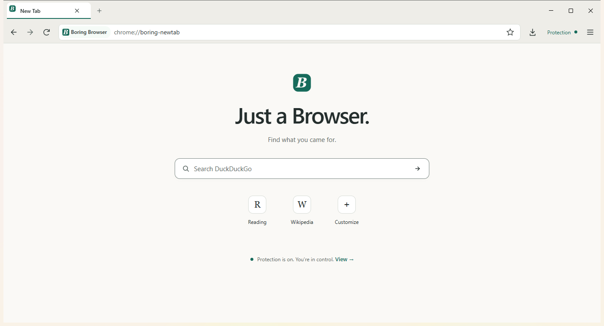
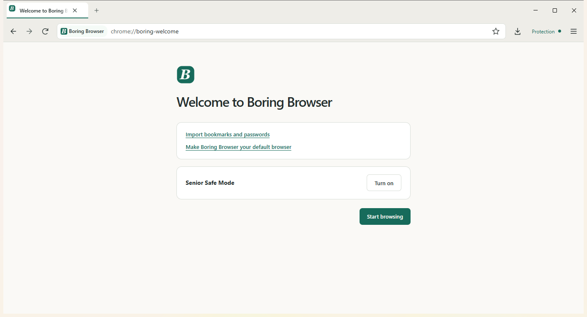
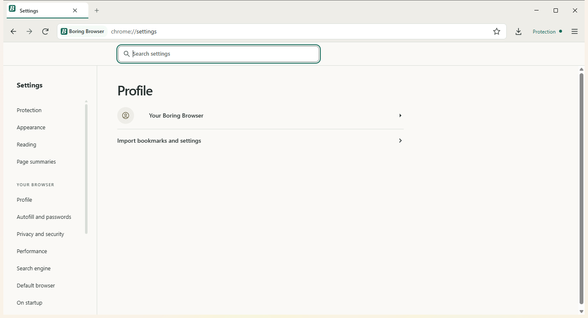
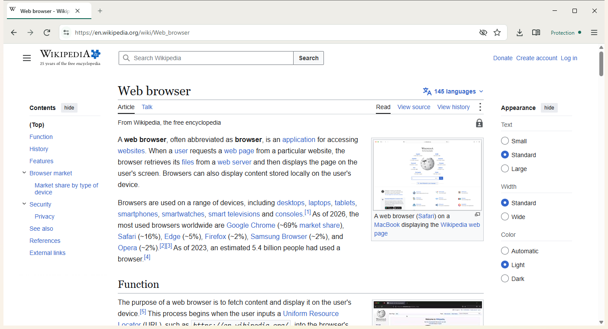

# the boring web browser

A plain, private Windows browser. It is Chromium's engine, de-Googled by
ungoogled-chromium, with a small patch layer on top for blocking, privacy
defaults and a calmer UI. It is not a new engine.

## Release 1

- Chromium 153.0.8010.52, via ungoogled-chromium 153.0.8010.52-1.1.
- Windows x64 only.
- Not code signed. SmartScreen will warn. Do not turn it off; check the
  SHA-256 from the release page instead.
- Downloads: the [release 1 page](https://github.com/JD-D3V/boring-web-browser/releases/tag/v153.0.8010.52.1),
  with the installer, the zip and `SHA256SUMS.txt`.

## On by default

- Ad, tracker and pop-up blocking.
- HTTPS first (Chromium's balanced mode).
- A scam warning page for sites on a built-in list, and Quad9 secure DNS.
  Quad9 refuses known malware and phishing domains, so they do not open.
  New sites get through.
- WebRTC kept to proxied routes.
- Fingerprint noise on canvas, text measurement and element sizes. Every
  page also reads the same graphics card name, a core count of 8, no touch
  points and a common screen size.
- Tracking parameters removed from links to other sites. The list comes
  from Brave; `utm_` tags are kept.
- DuckDuckGo search, with a picker on the new tab page.
- Cookie banners blocked, and answered with no where a page asks.
- Tracking redirects and AMP copies skipped, so a link opens the real page.
- Stop screen takeovers. A page cannot lock your keyboard, mouse or screen
  with fake alerts. Video fullscreen still works. If a page does lock up,
  one button closes the tab.
- Warn about scam tricks: downloads of remote control tools such as
  AnyDesk, a page that copies a command for you to run, and sites named
  like another site.
- A quiet note when a warning-looking page shows a phone number.
- Hide sponsored results on Google and Bing searches.

Also there:

- No way past scam warnings. Off by default, and offered on the Welcome
  page. It takes away the "continue anyway" link on a scam warning.
- Reader view from the toolbar.
- Page summaries, only on click. Off until you pick a provider. A remote
  provider receives the page text.
- Turn off blocking on one site from the toolbar shield. Chromium's own
  pop-up blocker stays on. The Protection page lists these sites. The
  shield also shows what was blocked on the page, and has Forget this
  site, clear on close and never sleep for that site.
- Fire button: wipe the whole session in one click.
- Split view. New profiles open where you left off.
- What the browser connects to, on the Protection page: every connection
  it makes on its own, why, and a switch for each. You can add your own
  filter lists by address (https only, weekly, 5 MB each). Programs on
  this computer that talk to add-ons are blocked until you switch them
  on, one by one, on new profiles. Password manager, AI and other add-ons
  have their own rows.
- Chrome Web Store extensions. Every install asks first. The store helper
  ([chromium-web-store](https://github.com/NeverDecaf/chromium-web-store)
  1.5.5.4) is built in, can be removed, and changes only with a browser
  update. It asks Google's update service about your store extensions
  every 5 hours.
- Spellcheck with Windows' own checker, and a bundled English (US)
  dictionary as a fallback. No download.
- Import from Chrome or Edge: bookmarks, history and search engines you
  added. Never passwords or cookies.

## Updates

Installed copies check for a new release once a day, using WinSparkle
and a fixed feed at `https://jd-d3v.github.io/boring-web-browser/appcast.xml`. A new
release installs only after you agree, and only if it carries a valid
EdDSA signature from our key. A copy run from the zip does not update;
use the installer for updates. The daily check can be turned off on the
Protection page.

## Not yet

- A broad scam list. The built-in one comes from CERT Polska and
  DurableNapkin only, so it is thin outside Poland. It changes only with
  a browser update.
- Widevine, so no Netflix or other DRM video.
- Sync. `sync-server/` is a separate Go server the browser does not use.
- Tor windows.
- Code signing.
- Blocking list updates. The lists are the ones built in.

## Honest limits

- Nothing has been independently audited.
- Protection is not antivirus. The scam list is short and mostly covers
  Poland. Quad9 only knows reported sites.
- The network behaviour of each build is measured before release and
  listed on the project's privacy page. Sites you visit and your search
  engine are contacted as you browse.
- One person maintains this. There is no support promise and no fixed
  update schedule.

## What is ours and what is upstream

| Layer | Whose |
| --- | --- |
| Blink, V8, the sandbox, site isolation | Chromium, untouched |
| De-Googling | [ungoogled-chromium](https://github.com/ungoogled-software/ungoogled-chromium) |
| `boring-core/patches/` (37 patches) | Ours. UI shape, settings, new pages, privacy defaults, packaging |
| `boring-core/components/boring/` | Ours. Blocking, per-site blocking off, Protection page, new tab, welcome, reader, summaries, tracking parameters, updater glue, Chrome and Edge import, store helper setup |
| Store helper | [chromium-web-store](https://github.com/NeverDecaf/chromium-web-store) by NeverDecaf, bundled with its self-update address removed and its check interval set to 5 hours |
| `boring-core/rust/` | Ours. Wraps the third-party `adblock` crate |
| `boring-core/tools/` | Ours. Apply, rebase, smoke tests, packaging |

HTTPS-first, secure DNS, WebRTC routing and the canvas, text and size
noise are Chromium and ungoogled-chromium features. Our part is turning them on by
default and showing them on the Protection page. The sandbox is never
turned off.

## Building

Windows only. Needs Visual Studio 2022 with C++, ATL and MFC, the Windows
11 SDK with Debugging Tools, Python 3.11+, Git, 7-Zip, ninja, Rust, and
about 100 GB free on an SSD.

1. Build [ungoogled-chromium-windows](https://github.com/ungoogled-software/ungoogled-chromium-windows)
   at tag `153.0.8010.52-1.1` with its own `build.py`.
   `--patch-set 153` below picks our patches rebased for Chromium 153.
2. Fetch the updater DLL, then apply our layer:

   ```
   python boring-core/tools/get_winsparkle.py
   python boring-core/tools/apply.py --patch-set 153 --src <checkout>\build\src
   ```

3. Build, from a VS developer prompt:

   ```
   set DEPOT_TOOLS_WIN_TOOLCHAIN=0
   cd <checkout>\build\src
   ninja -C out\Default chrome chromedriver mini_installer
   ```

4. Run a headless smoke check, for example
   `python boring-core/tools/smoke_scam.py`.

The full suite (`python boring-core/tools/smoke_all.py`) includes native
Windows checks. In a dedicated Windows test session, set
`BORING_ALLOW_HEADFUL=1` before running the suite or native capture tools.
Native browser windows can take focus even when positioned off screen.
Without that opt-in, the suite runs headless checks, reports native checks
as blocked, and returns a failing status. Build and release CI also require
that opt-in in their test session to complete the full suite.

More detail is in [docs/portfolio/BUILD.md](docs/portfolio/BUILD.md).

## Screenshots

Captured from an earlier build on Chromium 151. The Protection page has
changed since, so it is not shown.

| | |
| --- | --- |
|  |  |
| New tab | Welcome |
|  |  |
| Settings | An ordinary page |

## Licences

- Our code: [MIT](LICENSE).
- `boring-core/components/boring/privacy/tracking_params.cc`: MPL-2.0,
  adapted from Brave.
- `boring-core/components/boring/privacy/debounce_brave.inc`: MPL-2.0,
  Brave's debounce rules, unchanged. Our own rules are in
  `debounce_boring.inc`.
- Scam list: the CERT Polska Warning List (used under its data policy)
  and the DurableNapkin Scam Blocklist (MIT). The notice ships as
  `NOTICES-scam-blocklist.txt`.
- Cookie banner list: Easylist Cookie List, CC BY 3.0. The notice ships as
  `NOTICES-easylist-cookie.txt`.
- WinSparkle: MIT.
- chromium-web-store (NeverDecaf): MIT.
- English (US) spelling dictionary: SCOWL licence.
- The logo "B" is set in UnifrakturCook Bold, SIL Open Font License 1.1
  (copyright 2010 j. 'mach' wust; copyright 2009 Peter Wiegel). The font
  and its licence are in `boring-core/branding/source/`. The browser does
  not load the font.
- Chromium, ungoogled-chromium and their third-party parts keep their own
  licences. Their notices ship with the browser.

## More

- [docs/portfolio/ARCHITECTURE.md](docs/portfolio/ARCHITECTURE.md)
- [docs/portfolio/BUILD.md](docs/portfolio/BUILD.md)
- [docs/portfolio/LIMITATIONS.md](docs/portfolio/LIMITATIONS.md)
